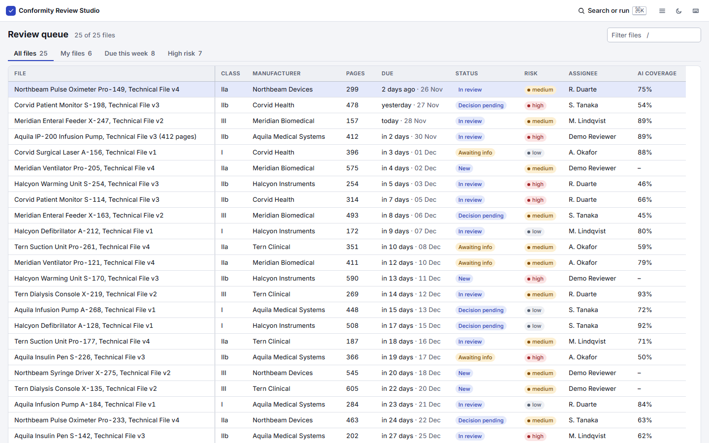
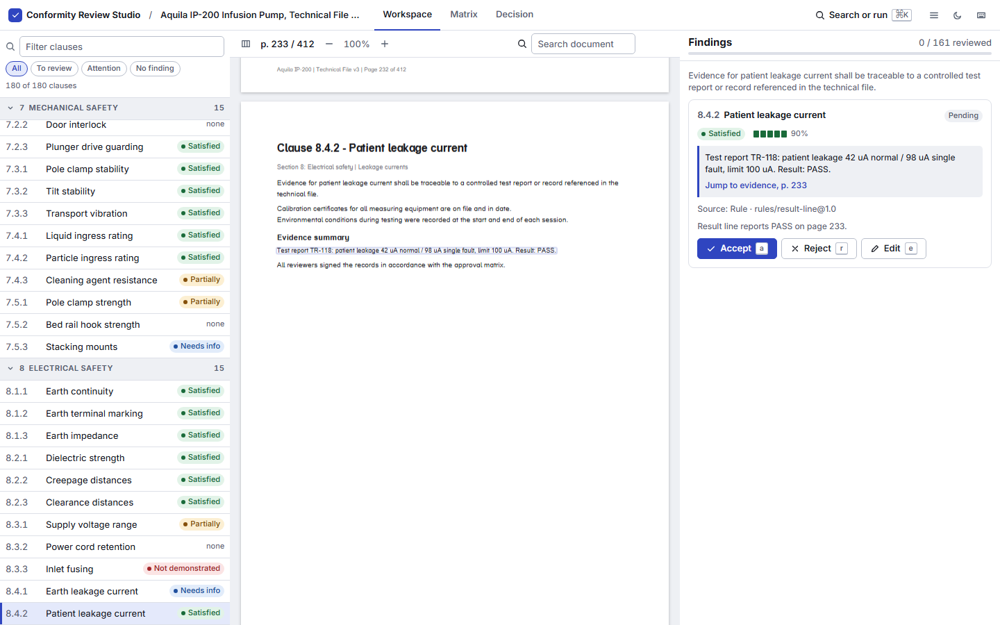
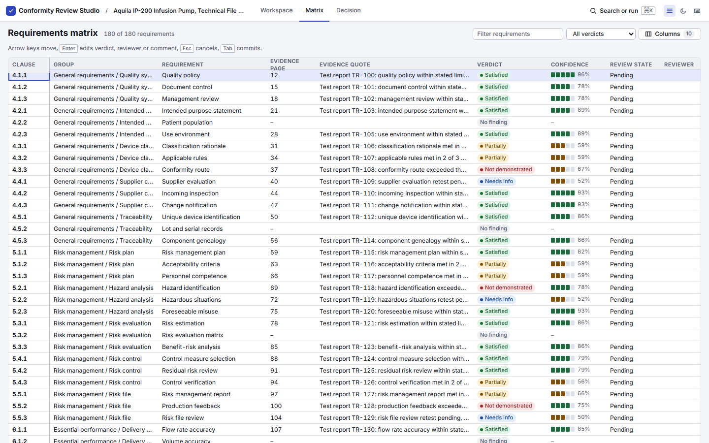
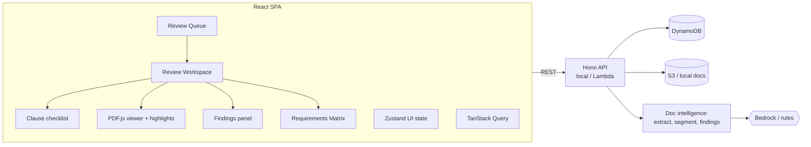

# Conformity Review Studio

[](https://github.com/mini4141/conformity-review-studio/actions/workflows/ci.yml)

A dense, AI-assisted technical-file review interface for certification bodies. A reviewer checks a 400-page technical file against a standard: the clause checklist, the document and the AI's findings sit side by side. Every finding links to highlighted evidence, corrections take one keystroke, and hundreds of requirement fields stay readable.

It is a designed and engineered product, not a mockup. The standard (`TS-60601-SIM`) and the technical file (a fictional infusion pump, 412 pages) are synthetic and generated by a script.

- Proof of everything running: [`proof/README.md`](proof/README.md)
- Case study / write-up: [`docs/PORTFOLIO.md`](docs/PORTFOLIO.md)
- Design rationale: [`docs/design/`](docs/design)

## Screens

| Review queue | Review workspace | Requirements matrix |
|---|---|---|
|  |  |  |

## Architecture



| Path | What |
|---|---|
| `apps/web` | React 19 + TypeScript SPA (Vite, React Router, TanStack Query/Table/Virtual, Zustand, pdfjs-dist, cmdk, Motion) |
| `packages/ui` | Design system: tokens (light/dark/density), components, Storybook stories |
| `packages/shared` | Shared data model types |
| `apps/api` | Hono API (Node server and Lambda), document intelligence, `rules` and `bedrock` providers, DynamoDB repo |
| `tools/sample-gen` | `pdf-lib` generator for the synthetic standard and technical file |
| `infra` | AWS CDK v2 (S3, CloudFront, API Gateway, Lambda, DynamoDB) |
| `e2e` | Playwright: end-to-end, visual baselines, perf, axe |

## Quickstart (local, no AWS calls)

Prerequisites: Node 24, pnpm, Docker Desktop (for DynamoDB Local).

```bash
pnpm install
scripts/dev-up.sh      # DynamoDB Local, sample data, API :8787, web :5173, Storybook :6006
scripts/dev-down.sh
```

Open http://localhost:5173, choose "Aquila IP-200 Infusion Pump" and press `j` / `k`, `a`, `r`, `e`, `g c`, `Cmd/Ctrl+K`, `?`.

| Command | Does |
|---|---|
| `scripts/seed.sh` | Reloads the demo data (25 files, the sample PDF, analysed findings) |
| `scripts/test-all.sh` | Typecheck, lint, Vitest + RTL, Storybook tests + axe, Playwright (e2e, visual, perf), Lighthouse CI |
| `scripts/capture-proof.sh phase1` | Regenerates the screenshots in `proof/phase1-local/screenshots` |

## Deploy to AWS and destroy

The showcase is ephemeral. Deployment runs from your machine with the profile `conformity-review-studio-deployer` in `ap-southeast-2`; GitHub Actions only builds and tests and never holds AWS credentials.

```bash
scripts/deploy.sh      # bootstrap (qualifier crstudio), build, cdk deploy, seed, smoke + e2e against CloudFront
scripts/destroy.sh     # empties buckets, cdk destroy --all, removes the toolkit stack
scripts/verify-destroyed.sh
```

## Stack

React 19, TypeScript, Vite, React Router, TanStack Query / Table / Virtual, Zustand, pdfjs-dist, cmdk, react-resizable-panels, Motion, Storybook 9, axe-core, Playwright, Vitest, React Testing Library, Lighthouse CI, Hono, Amazon Bedrock, DynamoDB, S3, CloudFront, API Gateway, Lambda, AWS CDK v2, GitHub Actions.
