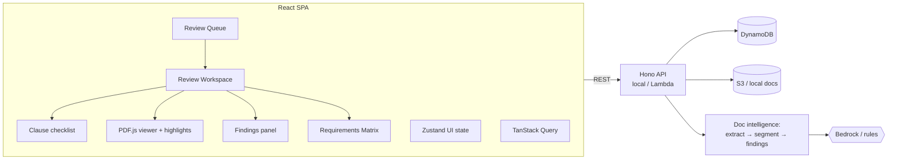

# SPECS.md: Conformity Review Studio

## 1. Summary

A **technical reviewer** at a notified body spends their day inside a 400-page technical file. They cross-reference clauses, check test reports against the standard, and decide whether a medical device conforms. Today that means Word, Acrobat and a spreadsheet.

Conformity Review Studio replaces those with one dense, calm interface:

| Area | What the reviewer gets |
|---|---|
| Queue | Files to review |
| Workspace | Clause checklist, the PDF with highlighted evidence, and AI findings, side by side |
| Matrix | A requirements matrix of hundreds of fields that stays readable |

The AI proposes; the reviewer verifies, corrects and decides, and every correction is captured. The front end is the product. The backend is a thin Hono API with PDF text extraction and Bedrock-generated findings.

**Demo story:**
1. Open the queue and pick "Aquila IP-200 Infusion Pump, Technical File v3 (412 pages)".
2. Press `j`/`k` through the findings.
3. One says clause 8.4.2 (leakage current) is satisfied by "Test report TR-118, p. 233". Click it, and the PDF jumps to p. 233 with the passage highlighted.
4. Another finding is wrong. Press `e`, correct it to "Not demonstrated" and give a reason.
5. Switch to the matrix to scan 180 requirement rows in compact density.
6. Record the conformity decision and export the report.

## 2. Requirement coverage matrix

| Requirement | Covered by | Proof |
|---|---|---|
| Thinks in finished interfaces | 3 screens built to production finish | Screenshots + visual baselines |
| Own layout, typography, interaction, motion, the design system and the React that ships it | `packages/ui`, tokens, Motion, the screens | Storybook + screenshots |
| How a reviewer sees a finding and corrects the model | FindingCard, the correction flow, diff view, override history | e2e + screenshots |
| Hundreds of fields of dense regulatory data made readable | RequirementsMatrix (virtualized, density modes, pinning) | Screenshot + perf log |
| Taste you can defend | `docs/design/principles.md` + `decisions.md` | Docs |
| Build the whole thing: design, frontend, state and data | Zustand/TanStack Query state, Hono API, DynamoDB | Code |
| Design for density, expert users, complex workflows | Keyboard-first, command palette, split panes | e2e |
| Interfaces where people review/correct AI output (signal) | Findings UX + corrections captured | Data |
| Design system built and maintained (signal) | Storybook with docs + a11y | Storybook URL |
| Ship to production | CloudFront deployment | Phase 2 proof |

## 3. Architecture



## 4. Repository layout

```
apps/web/            React app (routes/, features/{queue,workspace,matrix,decision}/, state/)
packages/ui/         design system (tokens/, components/, stories/)
apps/api/            Hono API (routes, doc-intel/, providers/{bedrock,rules}, ddb/)
tools/sample-gen/    synthetic technical file + standard generator (pdf-lib)
data/samples/        generated PDFs + standard JSON (committed if < 5 MB, else generated in seed)
infra/               CDK (TypeScript)
e2e/                 Playwright (+ __screenshots__ visual baselines)
docs/design/         principles.md, decisions.md, shortcuts.md
```

## 5. Features (end-to-end)

### F1: Review queue
- A dense table: file, device class, manufacturer, pages, due date (relative + absolute), status, risk, assignee and AI-coverage %. Saved views (My files, Due this week, High risk), quick filters, and keyboard row navigation. Opening a file goes to the workspace.
- **Accept:** 25 seeded files render, and the filter "High risk" narrows the list.

### F2: Review workspace (three panes)
- Left: the clause checklist of the fictional standard (about 180 clauses, grouped), with a status per clause.
- Centre: the PDF.js viewer, virtualized so 400+ pages are fine, with page thumbnails, search and evidence highlight overlays.
- Right: findings for the selected clause.
- Panes are resizable and the layout persists per user (Zustand persisted to localStorage, with a try/catch).
- **Accept:** selecting a clause scrolls the PDF to its evidence page and the highlight pulses (Motion).

### F3: AI findings and correction
- Each FindingCard shows the verdict (Satisfied / Partially / Not demonstrated / Needs info), the confidence, an evidence quote with a page link, its source (rule or model) and its history.
- Actions: Accept (`a`), Reject (`r`), Edit (`e`, opens an inline editor for verdict + reason + corrected evidence). The original is kept, and a diff view shows what changed.
- **Accept:** a correction persists and shows in the history after a reload.

### F4: Requirements matrix
- One row per clause, with about 12 columns: requirement text, evidence refs, verdict, reviewer, comment, last change and others. Virtualized rows, sticky header, pinned first column, inline editing with keyboard (Enter/Esc/Tab), the density toggle and a column visibility menu.
- **Accept:** 180 rows scroll smoothly (a perf log shows ≥ 55 fps average in a Playwright trace or the `performance` API), and an inline edit persists.

### F5: Conformity decision and export
- A decision panel shows the summary counts by verdict, unresolved items, the decision (Conforms / Conforms with conditions / Does not conform), the rationale and sign-off.
- Export as JSON and a printable HTML report (print CSS).
- **Accept:** the exported report contains the corrected finding.

### F6: Document intelligence (API)
- `POST /files` (upload) → extract text per page → segment headings → match clauses with keyword + embedding-free heuristics (rules provider) or the LLM (Bedrock provider: prompt with the clause + candidate passages, JSON-schema output) → store the findings.
- **Accept:** the sample file yields findings for at least 80% of the clauses.

### F7: Design system and Storybook
- Token docs (colour, type, spacing, density, motion), component docs with usage guidance, an a11y addon with zero serious violations, and interaction tests for FindingCard and the matrix cell editor.
- **Accept:** the Storybook build is published at `/storybook/` in the cloud.

## 6. Data model (DynamoDB single table)

| Item | PK | SK |
|---|---|---|
| File | `FILE#id` | `META` |
| Clause status | `FILE#id` | `CLAUSE#<clauseId>` |
| Finding | `FILE#id` | `FINDING#<id>` |
| Correction | `FINDING#id` | `CORR#<ts>` |
| Decision | `FILE#id` | `DECISION` |

GSI1 indexes files for the queue (`GSI1PK = QUEUE`, `GSI1SK = due#…`).

## 7. Interfaces

- `GET /files`
- `GET /files/:id`
- `GET /files/:id/pdf` (presigned URL or a stream)
- `GET /files/:id/clauses`
- `GET /files/:id/findings?clause=`
- `POST /findings/:id/actions {action, verdict?, reason?, evidence?}`
- `PATCH /files/:id/clauses/:cid`
- `PUT /files/:id/decision`
- `GET /files/:id/export`
- `POST /files` (upload + analyse)
- `GET /healthz`

## 8. Test plan

See CLAUDE.md §7. Visual baselines: queue, workspace, matrix and decision, each in light and dark.

## 9. Phase 1: Local

`scripts/dev-up.sh`: DynamoDB Local (Docker), generate the sample files, seed, then run the Hono API (:8787), Vite (:5173) and Storybook (:6006).

- [ ] `tests/`: Vitest, Storybook test-runner, Playwright (+ visual), Lighthouse reports
- [ ] `screenshots/01-queue.png`, `02-workspace.png`, `03-evidence-highlight.png`, `04-finding-correction-diff.png`, `05-matrix-compact.png`, `06-matrix-comfortable.png`, `07-command-palette.png`, `08-decision.png`, `09-dark-workspace.png`, `10-storybook-tokens.png`, `11-storybook-findingcard.png`
- [ ] `logs/perf-matrix-scroll.json`, `logs/axe-summary.json`, `docs/design/*.md`

## 10. Phase 2: AWS

| Local | AWS |
|---|---|
| Vite dev / Storybook dev | S3 + CloudFront (SPA at `/`, Storybook at `/storybook/`) |
| Hono node server | Lambda (Hono adapter) + API Gateway HTTP API, CloudFront behaviour `/api/*` |
| DynamoDB Local | DynamoDB table + GSI |
| local docs folder | S3 documents bucket (private, presigned GET) |
| rules provider | Bedrock provider for the sample file (cached) |

`scripts/deploy.sh`:
1. `cdk bootstrap` (qualifier).
2. Build the web app + Storybook.
3. `cdk deploy`.
4. Seed: upload the sample files, trigger the analysis.
5. Playwright e2e + visual against CloudFront.

- [ ] `screenshots/01-cf-workspace.png`, `02-cf-bedrock-findings.png`, `03-cf-storybook.png`
- [ ] `logs/bedrock-findings-sample.json`, `logs/cdk-deploy.log`, `resources.txt`
- [ ] `tests/playwright-cloud/`

## 11. Phase 3: Destroy

`cdk destroy --all --force`, then delete the toolkit stack and bucket.

`verify-destroyed.sh` checks for no CloudFront distribution, API Gateway API, Lambda, DynamoDB table or S3 buckets.

## 12. Out of scope

Real standards text, multi-user real-time collaboration, auth/SSO (a single demo reviewer), scheduling, and field inspection.
