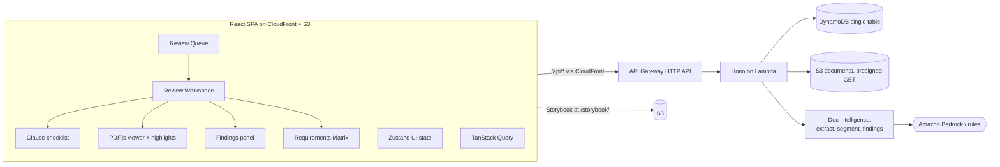
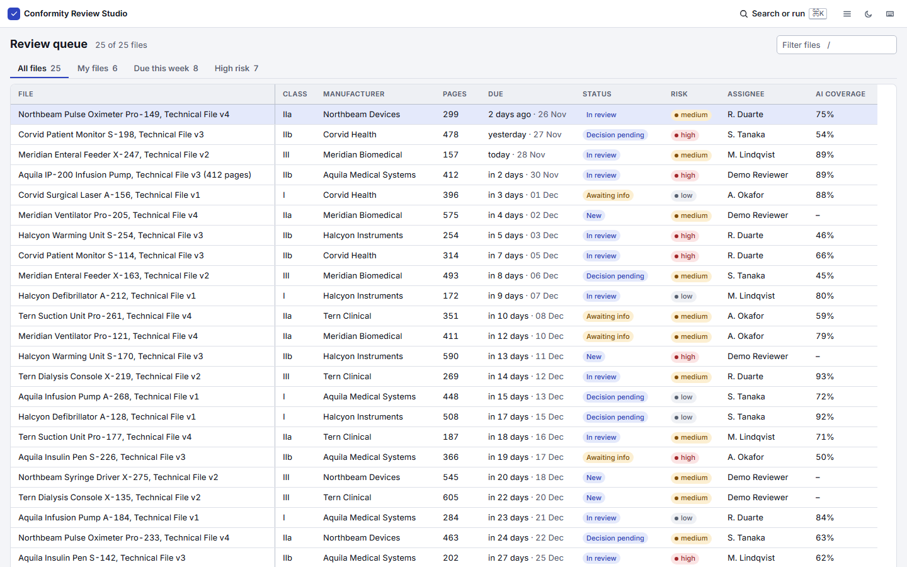
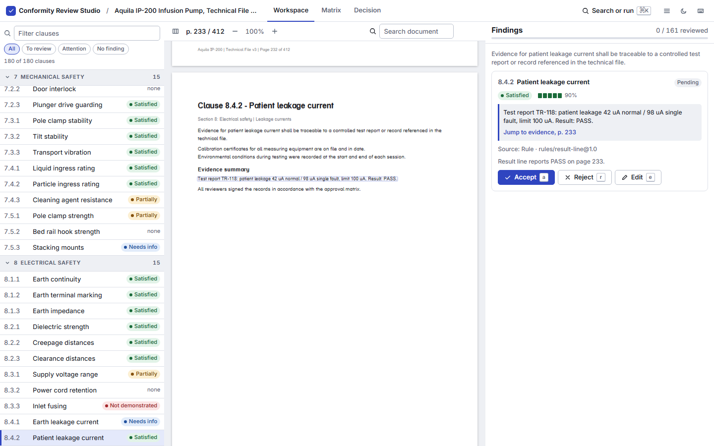
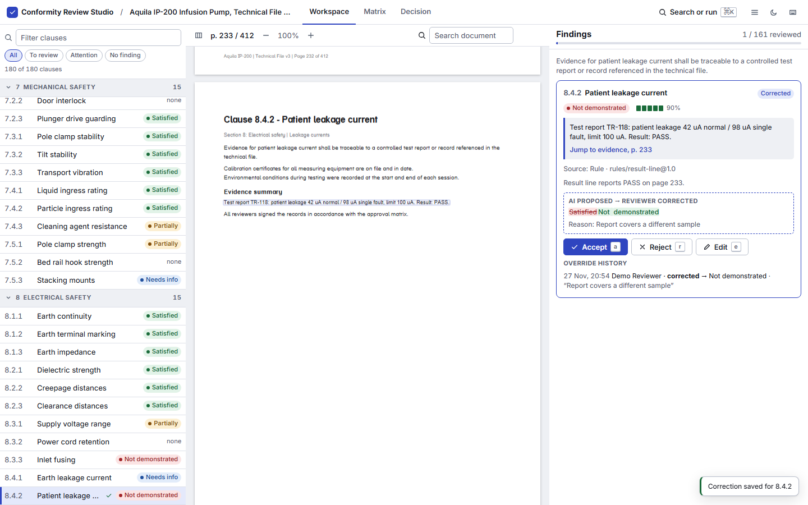
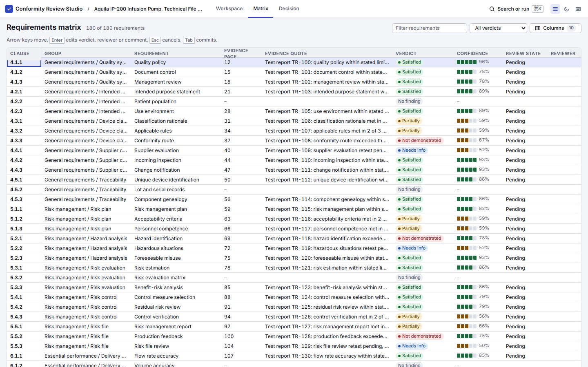
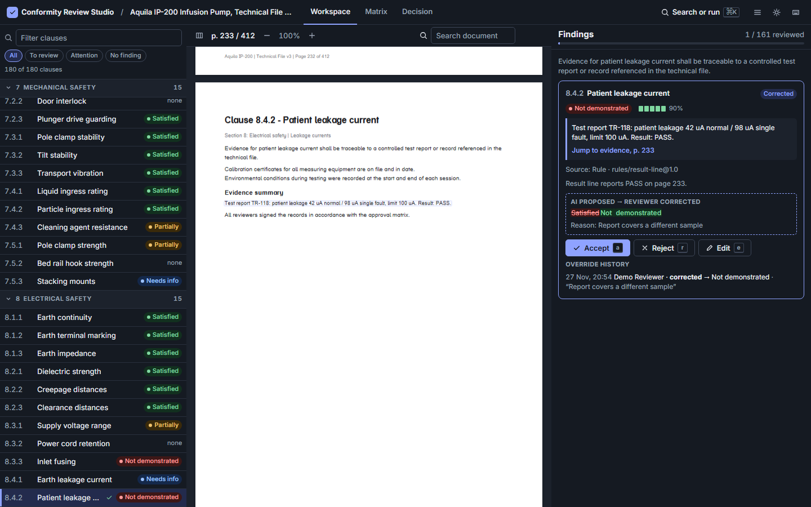
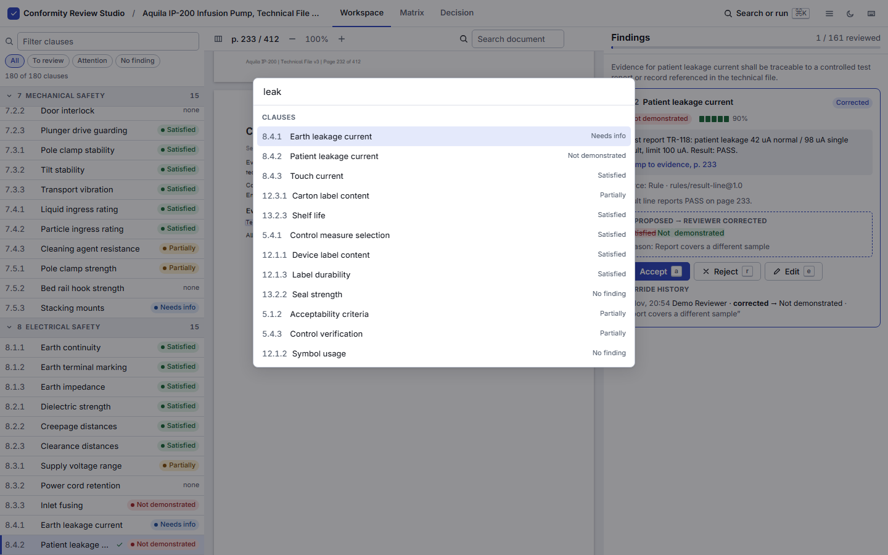
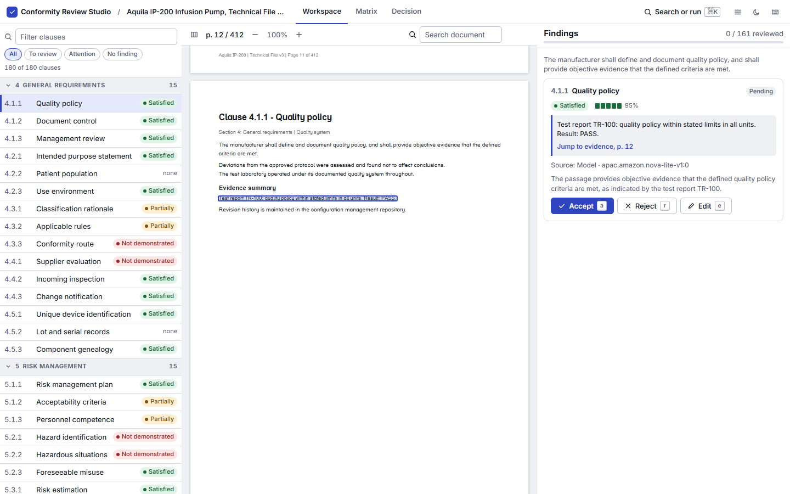
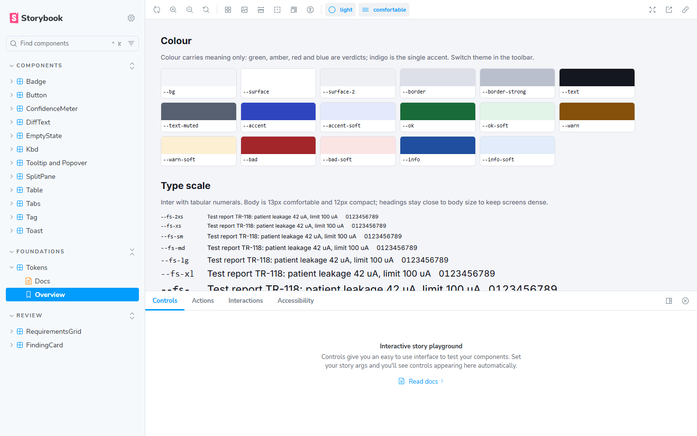

# Conformity Review Studio

A dense, AI-assisted interface for reviewing a 400-page technical file against a standard, built as a designed and engineered product rather than a mockup. Repository: https://github.com/mini4141/conformity-review-studio

## The problem

A technical reviewer at a notified body decides whether a medical device conforms to a standard. Today that is Word, Acrobat and a spreadsheet: the clause list in one window, the 400-page file in another, and the evidence trail in a third. When an AI proposes verdicts, the reviewer also has to decide how far to trust it, and every correction is lost.

The interface puts the three things side by side. The AI proposes, the reviewer verifies in one click, corrects with one keystroke, and the correction is captured with a reason while the model's original is kept.

## What it does

1. **Review queue.** 25 files in a dense, virtualized table with saved views (My files, Due this week, High risk), quick filters and keyboard row navigation.
2. **Review workspace.** Clause checklist (180 clauses), a virtualized PDF.js viewer (412 pages, thumbnails, search) and the findings panel in resizable panes whose layout persists. Selecting a clause jumps the PDF to the evidence page and pulses a highlight drawn from the PDF text positions.
3. **AI findings and correction.** Each finding shows verdict, confidence meter, evidence quote with page link, the producing rule or model and the reviewer's override history. `a` accepts, `r` rejects, `e` corrects (verdict, reason, evidence); a word-level diff shows what changed.
4. **Requirements matrix.** 13 columns by 180 rows with a sticky header, pinned first column, a column menu, comfortable/compact density, and keyboard cell editing.
5. **Decision and export.** Summary by verdict, unresolved items, decision with rationale and sign-off, JSON and printable HTML report that contains the corrected findings.
6. **Document intelligence API.** PDF text extraction, clause heading segmentation, and findings from a deterministic rules provider or an Amazon Bedrock provider with structured (tool-call) output, validated against the source text and capped per file.

## Architecture



Locally the same code runs against DynamoDB Local and a folder of documents, with the rules provider, and makes no AWS calls.

## Stack to requirement

| Requirement | Technology | Where it shows |
|---|---|---|
| Finished interfaces, dense expert UI | React 19, TypeScript, Vite, React Router | Queue, workspace, matrix, decision screens |
| Server state | TanStack Query | Optimistic cache updates after accept/correct/edit |
| UI state | Zustand (persisted with try/catch) | Theme, density, pane layout, palette, selection |
| Hundreds of fields readable and fast | TanStack Table + Virtual | Matrix and queue, 55 to 59 fps average while scrolling 180 rows (production build, headless Chromium, software raster) |
| Evidence you can verify | pdfjs-dist (canvas, text layer, highlight overlays) | Jump to p. 233, pulsing highlight, search, thumbnails |
| Keyboard-first | `cmdk`, custom hotkeys | `j k a r e`, `g c`, Cmd/Ctrl+K, `?` |
| Expert workspace | react-resizable-panels | Three resizable, persisted panes |
| Design system | `packages/ui`: tokens (light/dark/density), 14 components | Used in every screen and documented in Storybook |
| Meaningful motion | Motion | State springs, evidence pulse, toasts; reduced motion respected |
| Docs and QA | Storybook 9, axe-core | 36 stories with interaction tests; zero serious axe violations |
| Tests | Vitest + RTL, Playwright (e2e + visual), Lighthouse CI | 8 visual baselines, a full review journey, perf 0.99, a11y 1.0 |
| Thin backend | Node, Hono (local server and Lambda), unpdf | `apps/api` |
| AI review | Amazon Bedrock Converse with forced tool use, rules fallback | Findings tagged with their source rule or model |
| Data | DynamoDB single table + GSI, S3 | Files, clauses, findings, corrections, decisions |
| Sample data | pdf-lib generator | Synthetic 412-page technical file and a fictional standard |
| Infrastructure as code | AWS CDK v2 (TypeScript) | S3, CloudFront, API Gateway, Lambda, DynamoDB |
| CI | GitHub Actions | Typecheck, lint, unit, Storybook, Playwright on every push |

## Screens

| | |
|---|---|
|  |  |
| Review queue | Evidence jump: p. 233, highlighted passage |
|  |  |
| Correction with diff and override history | Requirements matrix, compact density |
|  |  |
| Dark theme | Command palette |
|  |  |
| On CloudFront: findings with a Bedrock model as source | Storybook design tokens |

The full proof index is in [`proof/README.md`](../proof/README.md). Design rationale: [principles](design/principles.md), [decisions](design/decisions.md), [shortcuts](design/shortcuts.md).

## What was hard

- **Highlights that stay on the right words.** Evidence rectangles are computed from pdf.js text item transforms and the viewport, so they follow zoom and stay aligned with the selectable text layer. The jump has to wait for the page to mount in a virtualized list, then centre the highlight, then pulse it.
- **60 fps on a 13-column grid.** The first version measured 26 fps in a production-like run. Memoising rows so scrolling only mounts new ones, turning off synchronous flushes in the virtualizer and measuring the production build (not the dev build) brought it to 55 to 59 fps depending on machine load (the test asserts the best of five runs and logs all of them).
- **Motion that never hides content.** With `prefers-reduced-motion` and a frozen test clock, an opacity fade on the route container stalled at 0 and the whole screen rendered blank in screenshots. Transitions are now transform-only, so a stalled animation can never hide a screen. Another surprise: current Chromium returns a promise from `scrollIntoView`, which breaks arrow-function `useEffect` cleanups.
- **Trust UX, not just a verdict.** A finding is only useful if it can be checked quickly, so every claim carries its quote, page link and source, and corrections keep the original and require a reason.
- **Toolchain drift.** New majors of TanStack Table, TypeScript and the Vite React plugin broke the Storybook and ESLint toolchains; versions are pinned deliberately and the lockfile is committed. Git Bash also rewrites environment values that look like paths (`/api`), which silently broke the production build until it was found.
- **Cloud limits shaped the design.** An HTTP API integration times out at 30 s, so analysis of the 412-page file runs from the deploy script (same code, real AWS) instead of inside a request; presigned S3 URLs with CORS serve the PDF.
- **Model access.** Claude on Bedrock was not enabled for the account (the Anthropic use-case form is an account-owner action), so the same Bedrock provider ran against Amazon Nova Lite; the fallback chain Claude, then Nova, then rules is logged (`proof/phase2-cloud/logs/bedrock-fallback.log`). Model output is accepted only if its quote appears verbatim in the passage; otherwise the rules result is used.

## Cost

The showcase stack ran for well under two hours. Everything is on-demand or free-tier-sized: Lambda at 1024 MB, DynamoDB on-demand, CloudFront PriceClass_100, S3, one HTTP API, and about 40 Bedrock calls on Nova Lite. The expected total is on the order of a few cents; billing data was not queried, so treat that as an estimate. There are no NAT gateways, databases with fixed hourly cost or reserved capacity. Everything is destroyed afterwards (see below).

## Reproduce

```bash
pnpm install
scripts/dev-up.sh            # local: DynamoDB Local, seed, API, web, Storybook
scripts/test-all.sh          # every local test layer
scripts/capture-proof.sh phase1

scripts/deploy.sh            # AWS: bootstrap, build, cdk deploy, seed, smoke + e2e, cloud screenshots
scripts/destroy.sh           # empty buckets, cdk destroy --all, remove the toolkit stack
scripts/verify-destroyed.sh  # exits non-zero if anything billable remains
```

Deployment uses the AWS profile `conformity-review-studio-deployer` in `ap-southeast-2`. GitHub Actions only builds and tests and never holds AWS credentials.
